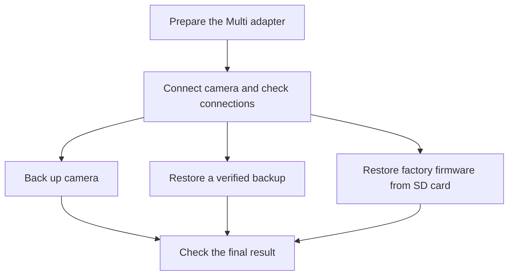

# A74 Recovery Tools

English | [简体中文](README_zh.md)

Back up and recover a Sony α7 IV (A7M4 / ILCE-7M4) using the Camera Recovery desktop app.

## Downloads

See [GitHub Releases](https://github.com/happyfrog2026/a74-recovery-tools/releases) for the Windows (x64) installer and the macOS (Apple silicon) DMG.

## What you need

- A Sony α7 IV with a charged battery, an RP2040-based Multi adapter, and two data-capable USB cables.
- Enough free disk space for a full camera backup. For factory firmware recovery, also have an SD card and the official Sony firmware package for your camera.

### Choose a Multi connection

- **For experienced DIYers:** Use a [DIY Multi service cable](https://github.com/DavidBuchanan314/ILCE-7M4-RE/blob/main/images/multi_breakout.jpg) if you have soldering experience.
- **For most users:** Choose the ready-made **Multi 15-Pin Breakout (M15PB1)** from Blue Potato Engineering for a more stable connection. Search **TEMU** for the product name, or register your interest at [bluepotato.shop](https://bluepotato.shop).

## Start here

1. Open **Prepare the Multi adapter**. Connect **USB 1 (RP2040)** to the computer and follow the app's setup prompts.
2. With the camera off, connect the Multi plug to the camera and both USB cables to the computer. Turn the camera on, then immediately click **Check connections**. On Windows, follow the WinUSB driver prompt if it appears.
3. Choose the operation you need.

| Operation | What to do |
| --- | --- |
| **Back up camera** | Choose a save location and start the backup. Wait for verification to complete and keep the entire backup folder. |
| **Restore saved state** | Select the verified `snapshot` folder or its parent backup task folder. Confirm and wait for the final result. |
| **Restore factory firmware from SD card** | Choose the camera model and follow the SD-card recovery prompts using the matching official firmware package. Wait for the camera to report completion. |

Keep power and the USB connections stable during backup and recovery.

## If guided SD recovery to an earlier version fails

Some cameras with previously modified firmware may fail when guided SD recovery tries to install an earlier firmware package.

1. Restore a known-good full backup from the same camera, or use guided SD recovery to reach a firmware version that boots normally.
2. On the working camera, choose **MENU → Setup → Reset/Save Settings → Setting Reset → Initialize**. [Sony Help Guide](https://helpguide.sony.net/ilc/2110/v1/en/contents/TP1000616558.html)
3. Once initialization is complete, retry guided SD recovery with the intended firmware package.

Example of a successful retry:

- Camera in a problematic state (originally version A) → version C directly → **failed**.
- Same camera → working version B → **Initialize** → retry version C → **succeeded**.

See [A7M4 firmware downloads](FIRMWARE.md) for Sony’s official download pages.

## License

The software is provided free of charge for noncommercial use under the [PolyForm Noncommercial License 1.0.0](LICENSE). Third-party components retain their original licenses and notices.
