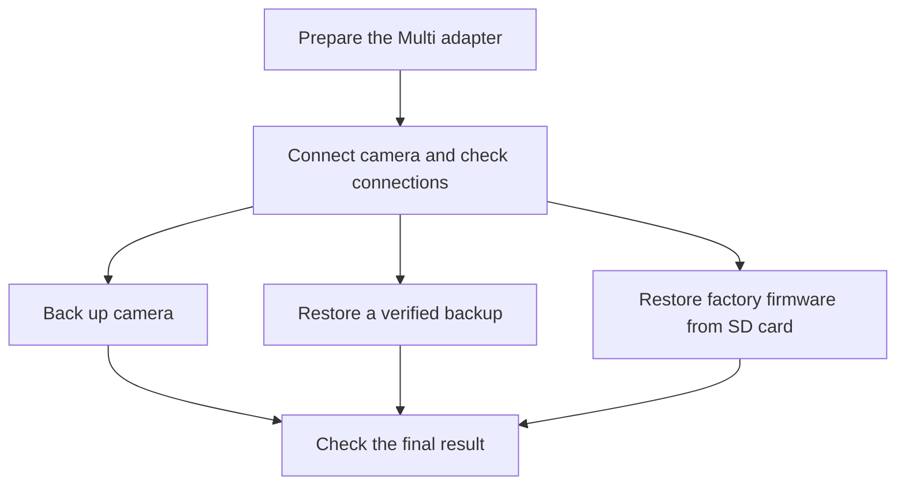

# A74 Recovery Tools

English | [简体中文](README_zh.md)

Back up and recover a Sony α7 IV (A7M4 / ILCE-7M4) using the Camera Recovery desktop app.

## Downloads

See [GitHub Releases](https://github.com/happyfrog2026/a74-recovery-tools/releases) for the Windows (x64) installer and the macOS (Apple silicon) DMG.

## What you need

- A Sony α7 IV with a charged battery, an RP2040-based Multi adapter, and two data-capable USB cables.
- **Choose one Multi connection.** A [DIY Multi service cable](https://github.com/DavidBuchanan314/ILCE-7M4-RE/blob/main/images/multi_breakout.jpg) suits users with soldering experience. For a ready-made option with a more stable connection, search TEMU for **Multi 15-Pin Breakout (M15PB1)** from Blue Potato Engineering, or register your interest at [bluepotato.shop](https://bluepotato.shop). This option suits most users.
- Enough free disk space for a full camera backup. For factory firmware recovery, also have an SD card and the official Sony firmware package for your camera.

## Start here

1. Open **Prepare the Multi adapter**. Connect **USB 1 (RP2040)** to the computer and follow the app's setup prompts.
2. With the camera off, connect the Multi plug to the camera and both USB cables to the computer. Turn the camera on, then immediately click **Check connections**. On Windows, follow the WinUSB driver prompt if it appears.
3. Choose the operation you need.

| Operation | What to do |
| --- | --- |
| **Back up camera** | Choose a save location and start the backup. Wait for verification to complete and keep the entire backup folder. |
| **Restore saved state** | Select the verified `snapshot` folder or its parent backup task folder. Confirm and wait for the final result. |
| **Restore factory firmware from SD card** | Choose the camera model and follow the SD-card recovery prompts using the matching official firmware package. Wait for the camera to report completion. |

Keep power and the USB connections stable during backup and recovery.

## License

The software is provided free of charge for noncommercial use under the [PolyForm Noncommercial License 1.0.0](LICENSE). Third-party components retain their original licenses and notices.
