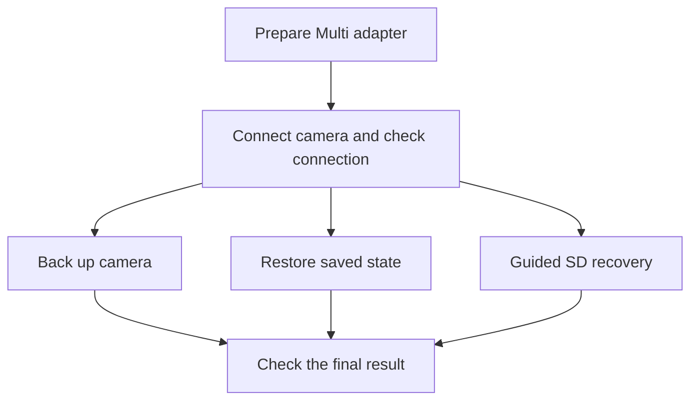

# A74 Recovery Tools

English | [简体中文](README_zh.md)

Back up and recover an α7 IV (A7M4 / ILCE-7M4) with the Camera Recovery desktop app. The SD recovery workflow also supports α7R V (ILCE-7RM5).

## Downloads

[GitHub Releases](https://github.com/happyfrog2026/a74-recovery-tools/releases) provides the Windows x64 installer and the macOS Apple silicon DMG.

## What you need

- A charged camera, an RP2040-based Multi adapter, and two data-capable USB cables.
- **For technical DIY users** — a [DIY Multi service cable](https://github.com/DavidBuchanan314/ILCE-7M4-RE/blob/main/images/multi_breakout.jpg) suits users with soldering experience.
- **For most users** — search **TEMU** for **Multi 15-Pin Breakout (M15PB1)** from Blue Potato Engineering, or [register interest](https://bluepotato.shop). The ready-made board provides a stable connection.
- Enough free space for a complete backup. Guided SD recovery also uses an SD card and the matching official firmware package.

## Start here

1. Open **Prepare Multi adapter** and connect **USB 1 (RP2040)** to the computer. If prompted, disconnect USB 1, hold the adapter's **BOOT** button, reconnect USB 1, release BOOT, and click **Check adapter**.
2. With the camera off, connect the Multi plug and both USB cables. Turn the camera on and immediately click **Check connection**. Follow the Windows USB driver prompt when shown.
3. Select an operation.

| Operation | What to do |
| --- | --- |
| **Back up camera** | Choose a destination, wait for verification, and keep the whole backup folder. |
| **Restore saved state** | Select the verified `snapshot` folder or its parent backup folder and start a fresh restore task. |
| **Restore stock from SD card** | Select the camera model and follow the card preparation and recovery prompts. |

Keep power and connections stable until the app and camera finish. The SD page includes expandable tips for restoring modified firmware and links to additional downloads.

## Source development

This source baseline is **0.1.52**. The desktop frontends use a shared Python JSONL worker.

- `native/CameraRecoveryApp.swift` — macOS SwiftUI frontend.
- `windows/app/` — Windows Electron frontend.
- `windows/worker_entry.py` — Windows runtime integration and UTF-8 protocol setup.
- `recovery_tool/` — backup, recovery, USB transport and durable task state.
- `tests/` and `windows/tests/` — offline regression and interface checks.
- `tools/` — preparation of local upstream runtime resources.

Initialize the pinned upstream dependency with `git submodule update --init --recursive`. See [development](docs/development.md), [resource preparation](docs/resources.md), and [upstream versions](UPSTREAMS.json).

## License

The software is provided free of charge for noncommercial use under the [PolyForm Noncommercial License 1.0.0](LICENSE). Third-party components keep their original licenses and notices. See [third-party notices](THIRD_PARTY_NOTICES.md).
