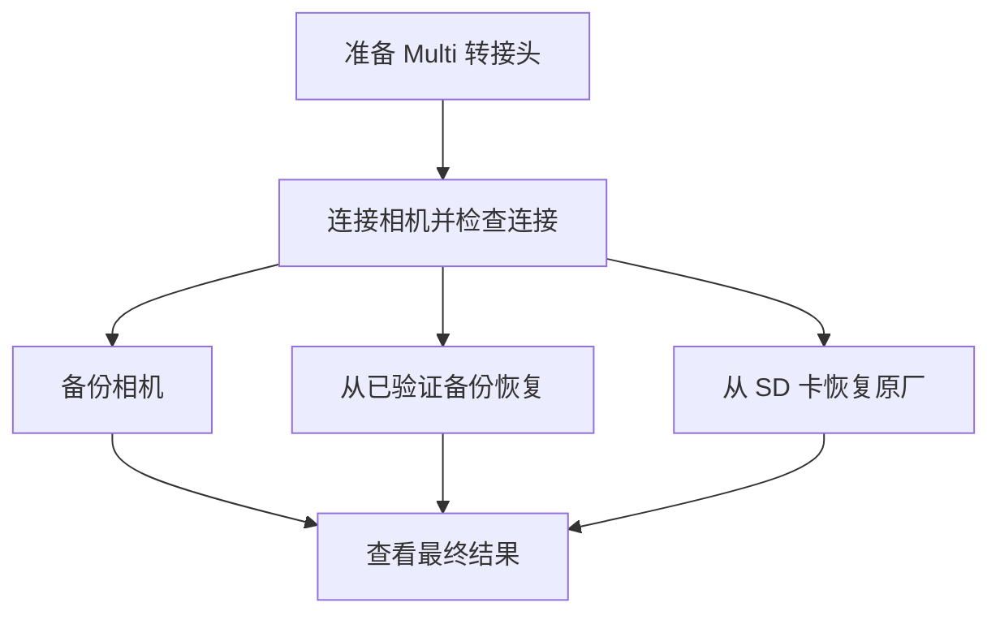

# A74 相机恢复工具

[English](README.md) | 简体中文

使用 Camera Recovery 桌面 App 备份和恢复 Sony α7 IV（A7M4 / ILCE-7M4）。

## 下载

请到 [GitHub Releases](https://github.com/happyfrog2026/a74-recovery-tools/releases) 获取 Windows（x64）安装包或 macOS（Apple 芯片）DMG。

## 使用前准备

- 一台电量充足的 Sony α7 IV、基于 RP2040 的 Multi 转接头，以及两条支持数据传输的 USB 线。
- 预留足够的磁盘空间保存整份相机备份。从 SD 卡恢复原厂固件时，另需准备存储卡及与机型匹配的索尼官方固件包。

### 选择 Multi 接线方式

- **有焊接经验的用户**可使用[自制 Multi 工程线](https://github.com/DavidBuchanan314/ILCE-7M4-RE/blob/main/images/multi_breakout.jpg)。
- **一般用户**可选现成的 **Multi 15-Pin Breakout (M15PB1)**（蓝色土豆），接线更方便，信号也更稳定。可在**闲鱼**搜索商品名。

## 使用步骤

1. 打开「准备 Multi 转接头」，将 **USB 1（RP2040）** 接到电脑，按 App 提示完成安装。
2. 相机关机时接好 Multi 插头，并将两条 USB 线接到电脑。打开相机后，立刻点击「检查连接」。Windows 如提示缺少 WinUSB 驱动，按页面提示安装。
3. 选择要执行的操作。

| 操作 | 怎么做 |
| --- | --- |
| **备份相机** | 选择保存位置并开始备份。等校验完成后，保留整个备份文件夹。 |
| **恢复已保存状态** | 选择已验证的 `snapshot` 文件夹，或它上一级的备份任务文件夹。确认后等待最终结果。 |
| **从 SD 卡恢复原厂** | 选择相机型号，使用匹配的官方固件包，按 App 提示准备 SD 卡并执行恢复。以相机显示完成为准。 |

备份和恢复期间，请保持相机供电及 USB 连接稳定。

## SD 卡引导恢复旧版本失败时

部分改过固件的相机，直接通过 SD 卡引导安装较早的固件时可能会失败。

1. 从同一台相机的正常全量备份恢复，或通过 SD 卡引导恢复到能正常开机的固件版本。
2. 确认相机能正常进入菜单后，依次选择 **MENU → 设置 → 重置/保存设置 → 出厂重置 → 初始化**。[索尼帮助指南](https://helpguide.sony.net/ilc/2110/v1/zh-cn/contents/TP1000618848.html)
3. 初始化完成后，再用目标版本的固件包执行 SD 卡引导恢复。

一次成功重试的示例：

- 有问题的相机（原本是版本 A）→ 直接安装版本 C → **失败**。
- 同一台相机 → 恢复到能正常运行的版本 B → **出厂重置（初始化）** → 重试版本 C → **成功**。

索尼官方固件下载入口见 [A7M4 固件下载](FIRMWARE.md)。

## 许可

本软件免费提供，仅供非商业用途，采用 [PolyForm Noncommercial License 1.0.0](LICENSE)。第三方组件保留各自原有的许可证及声明。
