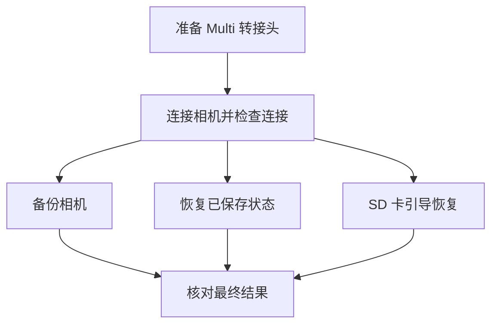

# A74 Recovery Tools

[English](README.md) | 简体中文

使用 Camera Recovery 桌面应用，为 α7 IV（A7M4 / ILCE-7M4）备份和恢复。SD 卡引导恢复也支持 α7R V（ILCE-7RM5）。

## 下载

[GitHub Releases](https://github.com/happyfrog2026/a74-recovery-tools/releases) 提供 Windows x64 安装包和 macOS Apple silicon DMG。

## 使用前准备

- 电量充足的相机、基于 RP2040 的 Multi 转接板，以及两条支持数据传输的 USB 线。
- **有焊接经验的用户** — 可以制作[工程线](https://github.com/DavidBuchanan314/ILCE-7M4-RE/blob/main/images/multi_breakout.jpg)。
- **一般用户** — 可在 **闲鱼**搜索 **Multi 15-Pin Breakout (M15PB1)**（蓝色土豆）。现成转接板接线方便，信号稳定。
- 保存完整备份所需的磁盘空间。SD 卡引导恢复还需要存储卡和匹配机型的官方固件包。

## 开始使用

1. 打开**准备 Multi 转接头**，将 **USB 1（RP2040）**接到电脑。如果出现提示，先断开 USB 1，按住 RP2040 的 **BOOT** 键，接回 USB 1，松开 BOOT，再点击**检查转接头**。
2. 相机关机时接好 Multi 插头和两条 USB 线。开机后立即点击**检查连接**。Windows 出现 USB 驱动安装提示时按应用引导操作。
3. 选择需要的功能。

| 功能 | 操作 |
| --- | --- |
| **备份相机** | 选择保存位置，等待验证完成，保留整个备份文件夹。 |
| **恢复已保存状态** | 选择已验证的 `snapshot` 或其上一层备份任务文件夹，新建恢复任务。 |
| **从 SD 卡恢复原厂** | 选择相机型号，按提示准备存储卡并执行引导恢复。 |

操作期间保持供电和连接稳定，等待应用与相机完成。SD 页面包含可展开的使用提示，以及更多下载链接。

## 源码开发

本次源码基线为 **0.1.52**。两端界面共用 Python JSONL 后端。

- `native/CameraRecoveryApp.swift` — Mac SwiftUI 界面。
- `windows/app/` — Windows Electron 界面。
- `windows/worker_entry.py` — Windows 运行环境适配和 UTF-8 通信。
- `recovery_tool/` — 备份、恢复、USB 通信和持久化任务状态。
- `tests/`、`windows/tests/` — 离线回归与界面检查。
- `tools/` — 本地上游运行资源准备。

使用 `git submodule update --init --recursive` 初始化固定版本的上游依赖。详见[开发说明](docs/development.md)、[资源准备](docs/resources.md)和[上游版本](UPSTREAMS.json)。

## 许可

软件免费提供，按 [PolyForm Noncommercial License 1.0.0](LICENSE) 许可用于非商业用途。第三方组件保留原有许可与声明，详见[第三方说明](THIRD_PARTY_NOTICES.md)。

（桌面安装包的打包流程保留在本地。固件输入和生成的运行资源按资源说明单独准备。）
